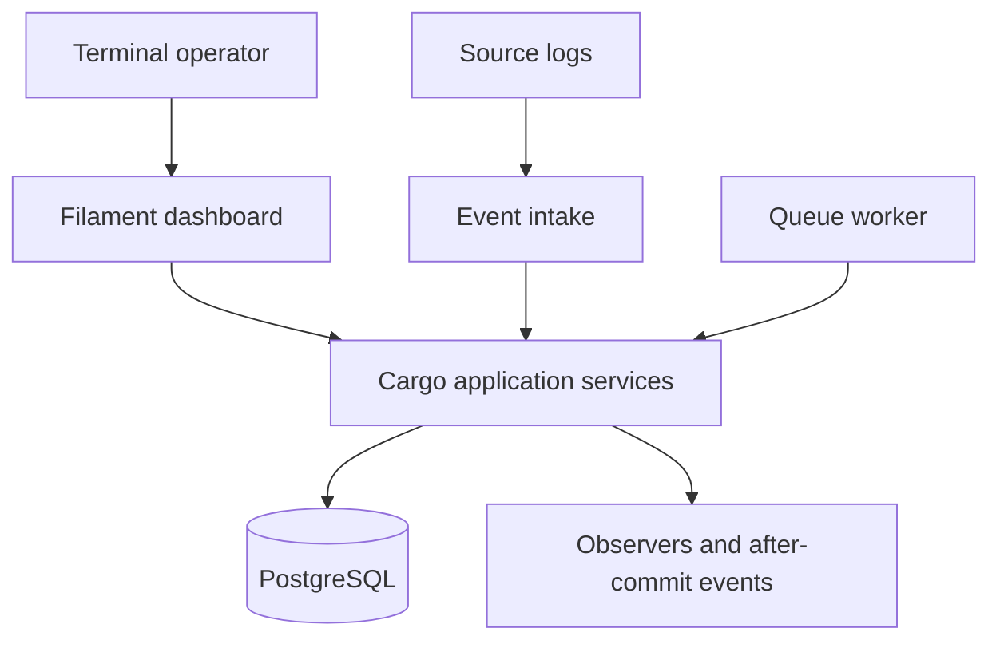

## 1. Purpose and scope

Build a Laravel and FilamentPHP cargo-handling application for Bulkstream's assessment. It records the movement of bulk liquid cargo from a vessel to a shore tank and from a tank to a truck. The core must enforce tank capacity, apply a 0.5% inbound transit loss, process source events in timestamp order and protect balances from concurrent operations.

The application is one deployable, modular service. It includes an operational dashboard, a durable event-processing workflow and a PostgreSQL database. It does not depend on a separate microservice for each component.

**In scope:** CPO, CPOL and PFAD; tank and cargo records; inbound and outbound movements; asynchronous event ingestion; audit history; authentication; operational visibility; tests and documentation.

**Outside the assessment scope:** direct control of heaters, live sensor integrations, billing, customer portals and external integrations not required to demonstrate the workflow. CPO's temperature-control requirement is informational unless a real monitoring integration is implemented.

## 2. Requirements and assumptions

### Required by the brief

- Storage must never exceed a tank's capacity; overflow raises a custom domain exception.
- Apply a 0.5% transit mass loss to every inbound vessel flow.
- Sort source logs by timestamp before modifying balances, including when received asynchronously or out of order.
- Protect state from concurrent operations and allocation collisions.
- Use Laravel and FilamentPHP, including reactive frontend handlers, backend entity state hooks and clear separation of concerns.

### Assessment assumptions

- **Units:** The brief specifies mass loss but volume capacity, without density or temperature data. Store volumes in litres and apply the 0.5% rate to volume as an assessment simplification. This is not an exact mass-to-volume conversion; a real system needs a verified conversion basis.
- **Commodity compatibility:** A tank holds one commodity at a time. It can receive a different commodity after becoming empty; cleaning requirements are outside scope unless specified.
- **Time:** Store occurrence and receipt times in UTC. Display times in a configurable local timezone. A source must provide an occurrence time and stable event ID. The arrival timestamp is assigned by the server.
- **Order:** Events are ordered per tank by `(occurred_at, source_id, source_event_id)` using a stable, documented lexical comparison. The tie-breaker is deterministic, not proof of physical order; a source-provided sequence should replace it when available.
- **Opening stock:** A new tank starts at zero. Any existing balance must be established by an auditable opening movement, with its effective time and commodity, before later movements are applied.
- **Delivery:** The 0.5% adjustment applies to inbound vessel flows only. No additional outbound loss is assumed.

## 3. System context



The dashboard and source-log intake both use the same application services. A queue worker may process asynchronously, but the database is the durable source of events and balances. Queue delivery is a trigger, not a guarantee of chronological ordering or exactly-once processing.

## 4. Component responsibilities

| Component | Responsibility |
| --- | --- |
| Filament resources and widgets | Authentication, operational forms, reactive previews, tank and movement views, and useful errors. |
| Event intake | Validate the source envelope, assign receipt time, persist the source event idempotently and schedule processing. |
| Event processor | Select each tank's pending events in order, coordinate processing, detect late events and surface failures. |
| Cargo services | Apply inbound, outbound and opening movements; enforce business invariants inside transactions. |
| Domain calculations and exceptions | Calculate loss and quantities deterministically; describe capacity, stock, compatibility and ordering errors. |
| PostgreSQL | Persist source events, movements, balances and audit records; enforce constraints and provide row-level locks. |
| Observer / lifecycle hook | Record a secondary audit action or dispatch an after-commit notification. It does not own balance changes. |

A Filament action calls an application service; it must not modify tank balances directly through an ordinary model form. Any future API uses the same intake and processing rules.

## 5. Domain model

| Entity | Important fields | Responsibility |
| --- | --- | --- |
| Commodity | `code`, `name`, handling notes, temperature-control flag | Defines CPO, CPOL and PFAD. |
| Vessel | Unique reference, name | Identifies the origin of an inbound movement. |
| Truck | Unique reference or registration | Identifies the recipient of an outbound movement. |
| Tank | Unique reference, capacity, current balance, current commodity, last applied ordering key, processing status | Represents storage and its current projection. |
| Cargo event | Source ID, source event ID, type, tank, commodity, occurrence and receipt times, payload, status, error | Durable intake record and idempotency boundary. |
| Cargo movement | Event ID, type, tank, commodity, vessel or truck, quantities, applied rate, before/after balance, effective time | Immutable record of an applied operation. |
| Audit record | Actor or system, action, entity reference, time and relevant change | Explains operational changes and review actions. |

A tank has many events and movements; each successfully applied event has one effective movement in the basic flow. A movement references a vessel for inbound cargo or a truck for outbound cargo. Manual entries use a stable server-generated source/event ID and the same processing path as imported events.

### Constraints and representation

- Use fixed-precision decimal litres, for example `NUMERIC(18,3)`, with decimal-safe application arithmetic. Reject inputs exceeding supported precision; calculate the loss to three decimal places using a documented half-up rule and compute `received = source - rounded_loss`. Never use binary floats for stock calculations.
- Enforce `capacity > 0`, `balance >= 0`, `balance <= capacity`, non-negative loss, positive movement quantities, required foreign keys and valid event types/statuses in migrations where supported.
- Enforce unique `(source_id, source_event_id)` on events and a unique applied event reference on movements. On duplicate input, return the existing event only if its canonical payload matches; reject conflicting reuse of the same ID.
- Store loss rate on each inbound movement. Existing historical calculations do not change if a future rate changes.
- Treat the current tank balance as a transactionally maintained projection of the active movement history. Do not edit it directly through Filament. Do not reduce a tank's capacity below its current balance.
- Keep movement history and original event payloads. Corrections are explicit, authorised and auditable; never silently edit an applied movement.

## 6. Inbound and outbound operations

### Inbound vessel discharge

1. The operator or source submits a stable event ID, occurrence time, vessel, commodity, tank and declared volume.
2. Persist the validated event, then schedule processing after commit. The processor selects eligible events for the tank in order.
3. Start a transaction and acquire a row-level lock on the tank. Recheck event status, ordering key and commodity compatibility under the lock.
4. Compute loss as `round(source_volume × 0.005, 3)` and receipt as `source_volume − loss`. Check that the resulting balance does not exceed capacity.
5. Create the movement, update tank balance, commodity and last applied ordering key, and mark the event applied in the same transaction. Commit all changes together.
6. Show the source volume, loss, received volume and updated balance. On overflow, throw `TankCapacityExceededException` and roll back the movement and balance change. Record the event failure in a separate transaction so the issue remains visible.

Example: 100,000.000 L declared → 500.000 L loss → 99,500.000 L received. Exactly filling a tank is allowed; exceeding it is not.

### Outbound truck delivery

1. Accept a stable event ID, occurrence time, truck, tank, commodity and requested volume.
2. Process it through the same ordering and tank-locking path.
3. Under the lock, verify the commodity and ensure requested volume is positive and no greater than the current balance.
4. Create the delivery movement, decrease the balance, update the ordering key and mark the event applied in one transaction. Clear the tank's current commodity when its balance becomes zero.
5. Reject insufficient stock or mismatched commodity with a clear domain error and no partial balance change.

## 7. Event ordering and reconciliation

### Intake and normal processing

- Save events durably before dispatching processing. Dispatch after commit. A periodic recovery job should also discover pending events if dispatch fails.
- Store states such as `pending`, `applied`, `failed`, and `needs_reconciliation`, with a failure reason. Distinguish malformed intake from accepted events that fail domain processing.
- Serialize processing per tank with the tank row lock. While holding it, select the earliest pending event for that tank by the full ordering key; do not rely on job arrival order. Recheck status after acquiring the lock.
- Process pending events in order. An event that fails a domain rule is recorded as failed and blocks later events for that tank until resolved, because skipping it can change subsequent validity. Other tanks continue independently.
- A batch of shuffled events already in storage is sorted before balances change. No finite waiting period guarantees that an older event will not arrive later.

### Late arrivals

If a newly accepted event's full ordering key precedes the tank's last applied key, mark it `needs_reconciliation`, pause further application for that tank and leave the current balance unchanged. Surface the issue in the dashboard. Compare the full key, including ties, not just the timestamp.

**Target implementation:** An authorised operator triggers reconciliation. Lock the tank and use an auditable opening state or checkpoint before the late event. Build a candidate timeline from the original active events in order, including the late event. Recalculate loss using the rate captured for each original movement, apply capacity, stock and commodity rules at every step, and recompute balances. If any event conflicts, make no changes to the active projection; retain the late event and show the conflict for review. If valid, commit the new active projection, revised balance, ordering key and reconciliation audit record atomically. Retain previous movement versions and their before/after values as superseded history; never overwrite or delete them. Prevent duplicate active application of the same source event, while permitting historical versions.

If safe replay is not implemented within the assessment, retain the pause-and-flag behaviour and clearly document that full late-event reconciliation is incomplete. Do not apply later events around the gap or claim complete out-of-order support.

## 8. Concurrency and failure handling

The tank row lock is the serialization point for all balance-affecting operations, tank capacity changes and reconciliation. Use one database transaction for validation, movement creation, balance update and event status transition. If future operations affect multiple tanks, lock them in stable ID order to reduce deadlocks.

- Two receipts competing for the last available capacity are evaluated serially; at most the receipts that fit can succeed.
- A duplicate queue job rechecks event status under the lock and cannot apply an event twice. The unique source key and movement constraint provide database-level protection.
- On validation failure, roll back the business transaction, then persist the failure state separately. Do not expose a successful movement if the transaction fails.
- Retry transient failures, such as deadlocks, using bounded retries. Do not endlessly retry permanent validation failures. Recovery should rediscover pending work without duplicating effects.
- Publish notifications after commit. If guaranteed delivery is required, use an outbox; simple after-commit dispatch alone is not a durable delivery guarantee.

## 9. Dashboard and user experience

- **Overview:** tank utilisation, stock by commodity, recent movements and counts of failed or reconciliation-required events.
- **Tanks:** capacity, current balance, available capacity, commodity and processing status. Tank changes must respect the same transactional safeguards as movements.
- **Inbound discharge:** vessel, tank, commodity, event time and volume. Reactively preview the loss, receipt, available capacity and projected balance.
- **Outbound delivery:** truck, tank, commodity, event time and volume. Reactively preview available stock and projected balance.
- **Event and movement history:** filters for time, tank, commodity, source and status; show before/after balances and useful failure information. Expose reconciliation status and the authorised review action when implemented.
- Reactive values are previews only. Recalculate from persisted state inside the server-side transaction and report clear errors if another operation changed the balance.

Use the provisional brand-inspired palette: dark teal `#004D4D`, teal `#008080`, white `#FFFFFF`, light grey `#F4F6F6` and dark grey `#263238`. These are design approximations, not confirmed official brand codes. Ensure accessible contrast, responsive layouts and text labels for status indicators.

## 10. Security and operations

- Require authentication for the Filament panel. Apply Laravel policies to operational changes and reconciliation; limit administrative actions to authorised users.
- Validate and authorise all write paths on the server. Store secrets in environment configuration; never commit credentials or production data.
- Log event ID, tank ID, processing outcome and correlation ID without unnecessary sensitive information. Dashboard failures should have actionable messages; detailed errors belong in protected logs.
- Use migrations and seeders for a repeatable demo. Provide representative data for all three commodities, vessels, tanks and trucks. Document local startup, worker startup, test commands, demo credentials and deployment configuration in the README.
- A demo should use a suitable persistent database and queue worker, run with debug disabled and avoid public exposure of secrets. Backups, monitoring and recovery procedures should be documented for production use; do not present the assessment demo as production-ready without them.

## 11. Project organisation: backend and frontend

Use a **single Laravel project** containing both the backend and the Filament dashboard. Filament uses PHP, Livewire and Blade inside Laravel, so a separate `backend/` or `frontend/` application is not necessary for this assessment. The separation is by responsibility: `app/Domain` and `app/Application` contain cargo rules and workflows, while `app/Filament` and `resources/` contain the user interface.

The tree below is a proposed layout, not a list of files that already exist. Create classes and folders as needed. Filament-generated resource layouts vary by installed version; follow its generators and documentation instead of forcing a particular layout.

```text
cargo-handling-system/
├── AGENTS.md                         # Codex project instructions
├── README.md                         # Setup, demo, tests and assumptions
├── composer.json                     # PHP dependencies
├── package.json                      # Frontend build dependencies
├── artisan                           # Laravel command entry point
├── .env.example                      # Example configuration; no secrets
├── docker-compose.yml                # Optional local services
│
├── app/                              # PHP application code
│   ├── Domain/
│   │   └── Cargo/
│   │       ├── Exceptions/           # Overflow, stock and compatibility errors
│   │       ├── Services/             # Loss and domain calculations
│   │       └── ValueObjects/         # Decimal-safe quantity, ordering key
│   │
│   ├── Application/
│   │   └── Cargo/
│   │       ├── ReceiveVesselCargo.php
│   │       ├── DeliverCargoToTruck.php
│   │       ├── IngestCargoEvent.php
│   │       ├── ProcessTankEvents.php
│   │       └── ReconcileTankEvents.php  # When safe replay is implemented
│   │
│   ├── Models/                       # Eloquent entities and relationships
│   │   ├── Commodity.php
│   │   ├── Vessel.php
│   │   ├── Tank.php
│   │   ├── Truck.php
│   │   ├── CargoEvent.php
│   │   ├── CargoMovement.php
│   │   └── User.php
│   ├── Jobs/                         # Queued processing and recovery jobs
│   ├── Observers/                    # Entity hooks for secondary concerns
│   ├── Policies/                     # Authorisation rules
│   ├── Providers/                    # Application and Filament panel setup
│   ├── Http/
│   │   ├── Controllers/             # HTTP endpoints, if needed
│   │   └── Requests/                # HTTP input validation, if needed
│   │
│   └── Filament/                    # Dashboard: PHP and Livewire UI
│       ├── Resources/               # Tank, commodity, vessel, truck,
│       │                            # event and movement resources
│       ├── Pages/                   # Custom operation or review screens
│       └── Widgets/                 # Dashboard statistics and charts
│
├── resources/                        # Frontend templates and source assets
│   ├── views/                        # Blade views and custom UI components
│   │   └── filament/                # Custom panel views, when required
│   ├── css/
│   │   └── filament/                # Filament theme and brand colours
│   └── js/                          # Custom JavaScript, only when needed
│
├── public/                           # Web server document root and built assets
├── routes/                           # Laravel routes; optional ingestion endpoint
├── config/                           # App, queue and cargo configuration
├── database/
│   ├── migrations/                   # Schema, constraints and indexes
│   ├── factories/                    # Test data factories
│   └── seeders/                      # Commodities and representative demo data
├── tests/
│   ├── Unit/                         # Calculations and isolated rules
│   ├── Feature/                      # Workflows, auth and Filament interactions
│   └── Integration/                  # PostgreSQL ordering and concurrency
├── docs/
│   └── architecture.md              # This document
├── storage/                          # Runtime logs, cache and generated files
└── bootstrap/                        # Laravel bootstrap and generated cache
```

### Backend responsibilities

- **`app/Domain/Cargo/`:** reusable cargo concepts, decimal calculations and domain exceptions. Keep domain calculations independent of Filament and HTTP requests.
- **`app/Application/Cargo/`:** coordinates event intake, ordered processing, transactions, locks, movement creation and optional reconciliation. All entry points call these services.
- **`app/Models/`:** Eloquent persistence, relationships and casts. A model hook or observer may support audit or after-commit events, but must not silently perform balance transactions.
- **`app/Jobs/`:** invokes the same application services for asynchronous processing and recovery. Queue jobs do not determine event order.
- **`app/Policies/`, `app/Http/` and `routes/`:** authorisation and HTTP boundaries. Add an API or import endpoint only if the implementation needs one; the dashboard can use the shared services directly.
- **`database/`:** owns schema and demo data. Database constraints and transactional row locks protect invariants across all entry points.

### Frontend responsibilities

- **`app/Filament/Resources/`:** tables, forms and resource pages for operational records. Forms call application services rather than writing cargo balances directly.
- **`app/Filament/Pages/` and `Widgets/`:** custom operation screens, reconciliation review and dashboard summaries where standard resources are insufficient.
- **`resources/views/filament/`:** custom Blade templates only when Filament components cannot provide the required interface. Livewire interactions and reactive Filament handlers provide previews and feedback.
- **`resources/css/filament/` and `resources/js/`:** theme styles and optional client-side enhancements. Build assets with the project's configured frontend toolchain. Business rules remain on the server.
- **`public/`:** serves compiled assets and the application entry point. Do not place application logic or secrets here.

### Request flow

A dashboard submission follows `Filament form → application service → domain validation and calculation → database transaction → updated view`. An imported event follows `intake → durable event → queue trigger → ordered application service → database transaction`. Both paths share the same rules, locks and audit history.

## 12. Verification and acceptance

| Scenario | Expected outcome |
| --- | --- |
| 100,000 L inbound | 500 L loss and 99,500 L receipt under the volume assumption. |
| Receipt exactly fills tank | Accepted; balance equals capacity. |
| Receipt exceeds capacity | Custom exception; no movement or balance change; failure visible. |
| Delivery exceeds stock or has wrong commodity | Rejected; no partial change. |
| Invalid or unsupported quantity | Rejected before application. |
| Duplicate source event | One application only; conflicting payload for same ID rejected. |
| Shuffled pending records | Applied in occurrence-time order with deterministic ties. |
| Late event after later application | Tank paused and event flagged; successful replay or conflict handled atomically when supported. |
| Failed earlier event | Later events for that tank stay blocked; other tanks can proceed. |
| Concurrent receipts exceed remaining capacity together | PostgreSQL-backed parallel test proves no over-allocation. |
| Failure during transaction | Event, movement and balance remain consistent; failure is recorded separately. |
| Reactive UI | Preview and validation work; backend rejects stale submissions safely. |

Use unit tests for decimal calculations and rules, feature tests for services and Filament workflows, and integration tests against PostgreSQL for transactions, unique constraints and concurrent workers using separate connections/processes. SQLite-only tests do not prove row-lock behaviour. Record actual commands and results; do not claim tests or deployment have passed before running them.

## 13. Implementation order

1. Set up Laravel, Filament, PostgreSQL, authentication and the domain schema.
2. Implement fixed-precision calculations, capacity and stock checks, transactional movement services, idempotency and tests.
3. Add durable event intake, ordered per-tank processing, late-event detection and safe reconciliation or the documented pause-and-flag limitation.
4. Build the dashboard, reactive forms, history, error handling and a suitable backend hook.
5. Run unit, feature and PostgreSQL concurrency tests; seed a demonstrable scenario and complete the README.
